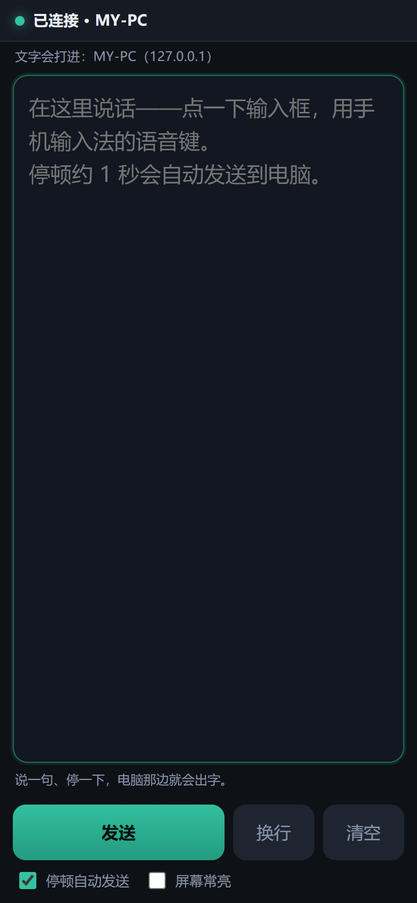

# TypeByVoice

**用手机的语音输入法，直接给电脑打字。** 手机负责"听"，电脑负责"打字"，中间的局域网链路常驻不断。

> Type with your phone's voice keyboard. The phone does the listening, the PC does the typing — over a LAN link that stays up.

<p align="center">
  
</p>

---

## 这是解决什么问题的

手机输入法的语音识别又快又准，但把说出来的字送进**电脑**很别扭：

- 厂商自带的"跨屏输入"通常是**按需会话**：每次要用都得在电脑上点开连接器、扫描二维码，用完关掉；闲置一会儿心跳超时，或者手机离开了那个跨屏页面，连接就断了，下次还得重来一遍。
- 手机麦克风在 Android 上基本只允许**前台**使用，App 一退到后台，录音就停。

所以"稳定的跨屏语音输入"不能靠修补厂商那个会话——它本来就是短连接设计。这个项目换了个思路：

```
┌──────────────┐   Wi-Fi / LAN    ┌───────────────────┐
│  手机浏览器   │ ─── WebSocket ──▶│  bridge.py (PC)   │
│  语音输入法   │                  │  注入到焦点窗口    │
│  ← 一个图标   │ ◀── ack/状态 ─── │  常驻 + 自愈       │
└──────────────┘                  └───────────────────┘
```

语音识别仍然由手机上你熟悉的那个输入法完成（识别质量一点不将就），本程序只负责把**文本**可靠地送进电脑光标处。

## 特性

- **常驻**：服务端一直在线，手机端断线自动重连（退避重连 + 心跳 + 僵死连接检测）。
- **自愈**：守护脚本看心跳文件，进程没了 15 秒内自动拉起；全程静默，不弹任何控制台窗口。
- **不丢字**：手机端离线队列（localStorage）重连后自动补发；服务端按 id 去重、确认后才删除。
- **不抢焦点**：点面板按钮会先把焦点还给上一个真实窗口；`launch.exe` 用 `CreateNoWindow` 启动，绝不闪窗。
- **多设备**：服务端支持多台手机同时在线，同一条消息只回给发它的那台。
- **看得见**：面板显示二维码/网址、连接状态、收/注入计数、最近记录、防火墙自检结果；手机页顶部显示"文字会打进：`电脑名`"。
- **零依赖**：只用 Python 标准库；`qrcode`/`Pillow` 只影响二维码图片，缺了照样能跑（用网址连）。

## 快速开始（Windows）

1. 装 Python 3.10+（勾选 *Add python.exe to PATH*）。
2. 双击 `run.bat`。首次运行会生成 `config.json`（内含随机访问令牌）并弹出面板。
3. 手机连**同一个 Wi-Fi**，扫面板上的二维码（或输入面板里的网址），浏览器菜单里选"添加到主屏幕"。

之后每次：手机点那个图标 → 点输入框 → 按输入法的语音键说话 → 停顿约 1 秒，文字自动出现在电脑当前光标处。

> 面板第一次启动时如果提示"未放行 8765"，点一下 **防火墙放行**（会弹 UAC）。Windows 可能把网络判成"公用/专用"，本程序两种都管。

## 日常用法

| 操作 | 说明 |
| --- | --- |
| 说话 | 手机输入框里正常用输入法的语音键；停顿 1.2 秒自动发送 |
| `发送` | 立刻发送（不想等停顿） |
| `换行` | 给下一句开头加一个回车（发送多行） |
| `清空` | 清掉输入框和未发送队列 |
| 屏幕常亮 | 勾上后手机不自动锁屏（Wake Lock） |
| `Ctrl+Alt+P` | 暂停/恢复注入（临时想用键盘打字时） |
| `Ctrl+Alt+Z` | 撤销上一句（按字数发送退格） |
| `Ctrl+Alt+B` | 唤出面板（也可以直接双击桌面快捷方式） |
| `注入暂存` | 把断线期间攒下的文字一次性补进当前窗口 |

面板上的 **测试注入(3秒)** 可以在一个临时窗口里验证注入链路是否正常，不会打扰你正在编辑的文档。

## 稳定性是怎么做到的

| 机制 | 实现 |
| --- | --- |
| 客户端重连 | 500ms 起指数退避到 6s；15s 心跳；45s 无消息判定僵死并重连；页面回到前台/网络恢复时主动探活 |
| 离线不丢 | 未确认消息存 `localStorage`，4s 重试，收到 `ack` 才移除 |
| 服务端去重 | 每条消息带 id，`recent_ids` 窗口内重复直接回 `ack` 不重复注入 |
| 注入失败重排队 | 注入失败的消息按 id 去重后放回 `pending`，不会静默丢失 |
| 单实例 | 端口被占用时不再起第二个进程，而是**唤出已有面板**（这就是"双击快捷方式"的正确行为） |
| 心跳 + 守护 | 主进程每 2s 刷新 `bridge.alive`；`watchdog.vbs` 3s 轮询，超过 15s 没更新就经 `launch.exe` 以 `--silent` 拉起，18s 冷却 |
| 静默启动 | `launch.exe`（winexe，`CreateNoWindow`）启动 `python.exe`，避免 `cmd`/`wscript` 弹控制台、抢焦点、打断输入法组字 |
| 开机自启 | 面板勾选后写启动项 `watchdog.vbs`（不是主程序，崩了也能拉起来） |
| 防火墙自检 | 每 30s 查一次端口规则/程序规则，并显示默认路由网卡属于 Public 还是 Private |

## 配置 `config.json`

```jsonc
{
  "port": 8765,          // 监听端口
  "token": "……",         // 访问令牌（首次运行随机生成；换掉它等于让旧链接立刻失效）
  "auto_inject": true,   // 收到就注入
  "paste_mode": false,   // 兼容模式：用剪贴板粘贴代替逐字符注入（某些程序不接受 SendInput）
  "hotkeys": true,       // 全局热键
  "auto_send_ms": 1200   // 手机端停顿多久自动发送（会下发给手机页）
}
```

命令行参数：`--port 8765`、`--no-gui`、`--minimized`、`--silent`（守护拉起用）、`--paused`。

## 常见问题

**手机提示"无法访问此网站"**
电脑防火墙没放行。点面板的 **防火墙放行**；或确认手机和电脑在同一网段（蜂窝网络、访客网络、VPN 都不行）。

**面板上的二维码在哪**
就是面板中间那块 220px 的图，在网址输入框正下方。如果面板被最小化/藏起来了：按 `Ctrl+Alt+B`，或双击桌面快捷方式（已在运行时，双击会唤出面板而不是再开一个）。

**为什么用 `python.exe` 而不是 `pythonw.exe`**
`pythonw.exe` 没有控制台，但部分机器的防火墙规则恰好只允许 `python.exe` 入站；而本程序的日志是写文件/面板的，不需要控制台。所以统一用 `python.exe` + `launch.exe`（隐藏窗口）启动。

**能不能把同一句话打进两台电脑**
不会。手机页只连它被打开的那个地址（`location.host`），桥之间没有转发。真正会让两台电脑都收到的情况只有一种：手机上同时开着两个页面，A 页留了没发完的草稿，你切到 B 页说话时 A 的草稿恢复联网自己发出去。一台手机只留一个图标即可避免。

**手机锁屏后就不出字了**
Android 只在 App 位于前台时允许录音。手机页勾选"屏幕常亮"，或者把浏览器页面留在前台。

**换手机/新增设备**
不需要配对，同一 Wi-Fi 打开面板上的地址（或扫码）即可；服务端支持多客户端同时在线。

## 文件结构

```
bridge.py                 服务端：HTTP + WebSocket + 文本注入 + 面板(Tkinter)
web/index.html            手机端页面（PWA，可添加到主屏幕）
web/manifest.webmanifest  手机端 PWA 清单
web/icon-*.png, icon.ico  图标
selftest.py               17 项自检（HTTP/WS/去重/注入/换行）
run.bat / stop.bat        启动 / 停止
tools/launch.cs           launch.exe 源码（无控制台启动器）
tools/build_launcher.bat  编译 launch.exe（可选，但强烈建议）
tools/make_icons.py       重新生成图标
tools/mobile_shot.py      用 Playwright 截 390x844 手机页，验收排版
tools/shot.ps1            抓某个窗口的截图（验收面板用）
```

运行期生成（已被 `.gitignore` 排除）：`config.json`、`state.json`、`bridge.alive`、`watchdog.alive`、`watchdog.vbs`、`stopped.flag`、`launch.exe`。

## 自检

```bat
python selftest.py
```

会起一个临时实例，检查 HTTP、二维码、令牌校验、路径穿越防护、WebSocket 握手与 `ack`、重复 id 去重、心跳、中文注入、换行转回车等 17 项。

## 安全与隐私

- 只监听局域网端口，**不上传任何内容到云端**；语音识别在手机端完成，电脑只收到最终文本。
- 访问需要 `config.json` 里的令牌（`?k=…`）；令牌不对直接 403。更换令牌即可让旧链接全部失效。
- 不记录按键、不读屏幕，只把收到的文本注入到当前焦点窗口。

## 限制

- 只在 Windows 上测试（注入用 `SendInput`；面板用 Tkinter）。
- 手机与电脑必须在同一局域网，且电脑防火墙放行该端口。
- 需要手机输入法自带语音键（绝大多数中文输入法都有）；本程序不包含任何语音识别模型。

## License

MIT
